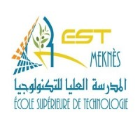
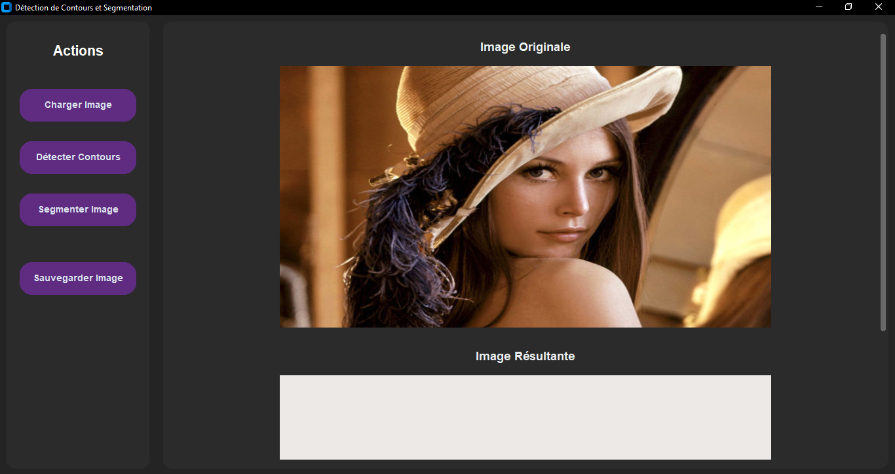
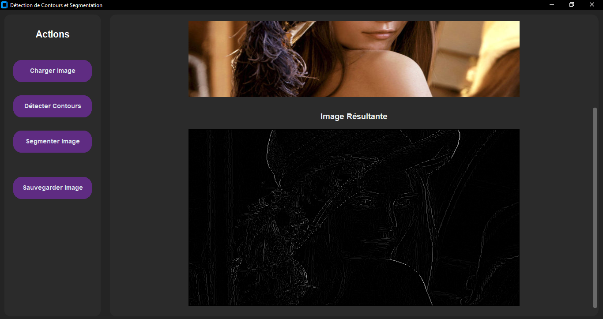
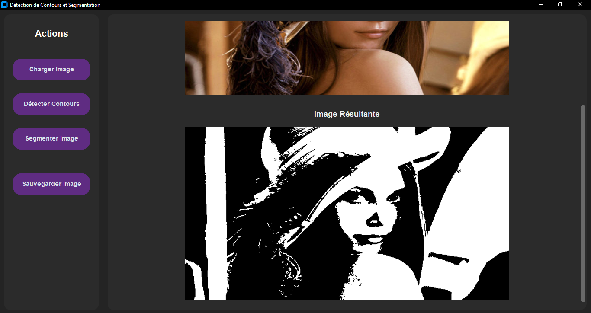

<div align="center">



# 👁️ Computer Vision from Scratch

### Image Segmentation & Contour Detection


</div>

---

## 📖 About

A small image-processing application with two core features, both implemented **from scratch**:

- **Image segmentation**: splits an image into distinct regions and produces a segmented result.
- **Contour detection**: highlights the edges and outlines of the objects in an image.

The goal of the project is to really understand how these algorithms work under the hood, instead of relying on high-level library functions. The algorithms are built with **NumPy** and **Pillow** (no OpenCV), and everything is driven by a simple graphical interface built with **CustomTkinter**.

Developed at **EST Meknès**, as part of my DUT in Artificial Intelligence & Emerging Technologies (IATE).

---

## ✨ Features

| Action | What it does |
| :-- | :-- |
| 📂 **Load image** | Opens an image from your computer and displays it |
| 🔍 **Detect contours** | Computes the contours of the loaded image and shows the result |
| 🧩 **Segment image** | Segments the loaded image and shows the resulting image |
| 💾 **Save image** | Saves the resulting image to your computer |

---

## 🖼️ Demo

| Original image | Contour detection | Segmentation |
| :--: | :--: | :--: |
|  |  |  |

---

## 🗂️ Project structure

```text
computer-vision-from-scratch/
├── main.py            # application entry point (CustomTkinter interface)
├── segmentation.py    # image segmentation
├── edges.py           # contour (edge) detection
├── filters.py         # image filters (Gaussian blur, median filter)
├── utilis.py          # helper functions (grayscale conversion, PIL/array conversion)
├── rapport_vision.pdf # project report
└── screen_*.PNG       # screenshots of the application
```

---

## 🚀 How to run

1. Clone the repository:

```bash
git clone https://github.com/ilyasNajim/computer-vision-from-scratch.git
cd computer-vision-from-scratch
```

2. Make sure **Python 3** is installed, then install the dependencies:

```bash
pip install numpy pillow customtkinter
```

3. Start the application:

```bash
python main.py
```

---

## 📄 Report

The full project report is available here: [rapport_vision.pdf](rapport_vision.pdf)

---

## 👤 Author

**Ilyas Najim** · AI & ML engineering student

<a href="https://www.linkedin.com/in/ilyas-najim-050215359/"></a>
<a href="https://github.com/ilyasNajim"></a>
